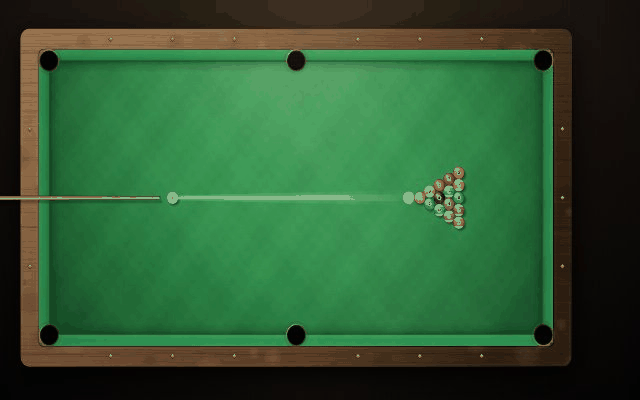
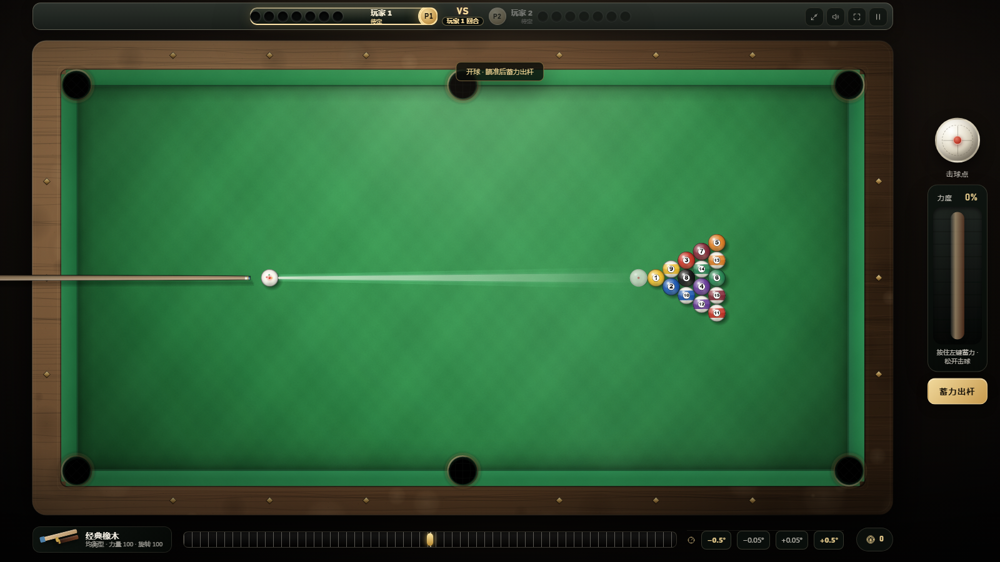
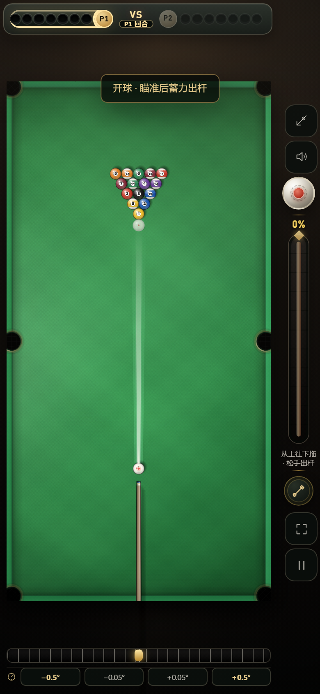
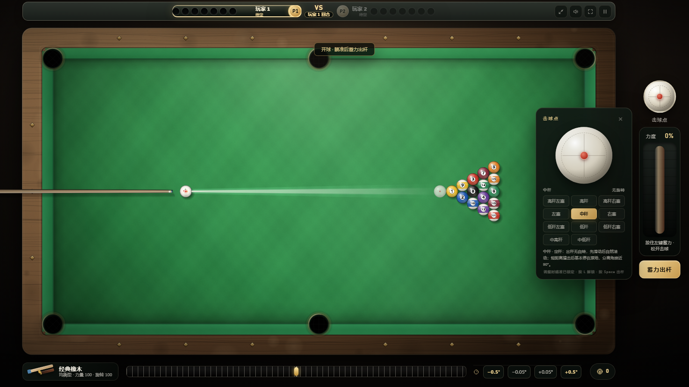
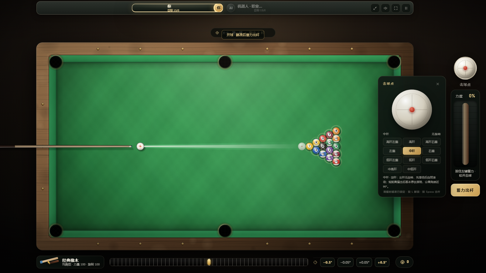
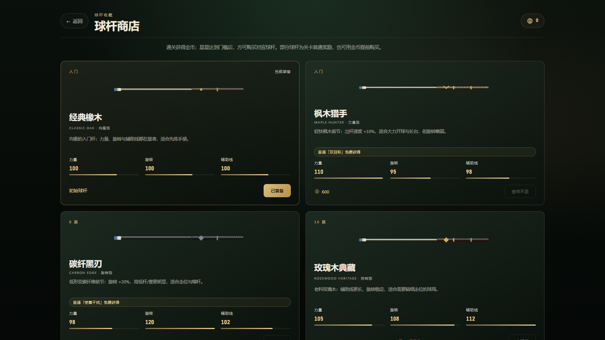
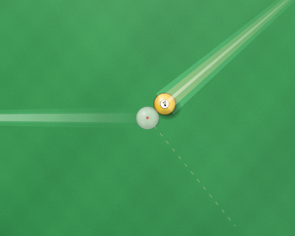

# PRO POOL · 即刻开球

[](https://xingshuwen.com/games/pool/)
[](LICENSE)
[](#testing)
[](#quick-start)

**English** | [简体中文](README.zh-CN.md)

> A real-physics 8-ball pool game that runs entirely in your browser.
> One HTML file. No dependencies, no network requests, no ads, no account.



## ▶ Play it now

**<https://xingshuwen.com/games/pool/>** — free, instant, desktop & mobile. No install, no signup.

## Screenshots

| Desktop match | Mobile portrait |
|---|---|
|  |  |

| 11 cue contact points | Puzzle levels |
|---|---|
|  |  |

| Cue shop | Ghost cue-ball aim |
|---|---|
|  |  |

## Features

- **Real physics, not canned animation.** Fixed 1/600 s substeps with continuous collision detection (contact-time normals), separate sliding/rolling friction, spin decay, cushion restitution and true pocket jaws. Fast shots never tunnel.
- **Aim assist that agrees with the physics.** A translucent *ghost cue ball* (rendered with the same sprite as the real cue ball) shows the exact contact position, plus target path and cue separation line.
- **11 named cue contact points** — centre, follow, draw, half-follow/half-draw, left/right english and the four corners — each with a plain-language effect description.
- **Three genuinely different AI tiers.** Rookie → Pro Sparring → 8-Ball Master. The master identifies every aimable shot and can run out a table; all tiers pot ~100% of the shots they choose to attempt (measured, see [Testing](#testing)).
- **Modes:** solo vs AI, local two-player, 12 hand-placed puzzle levels with star/coin rewards, and a cue shop (9 cues including novelty shapes) that changes power/spin/assist.
- **Full 8-ball rules:** open table after the break, two-cushion break requirement, ball-in-hand fouls, group assignment on first legal pot, 8-ball win/loss conditions.
- **Desktop + mobile.** Portrait phones get an auto-rotated vertical table; all touch targets ≥ 44 px; fine angle ruler (±0.05°/±0.5°) and keyboard shortcuts.
- **Sound without downloads.** WebAudio synthesis plus short embedded Creative-Commons samples (base64). Zero external requests at runtime.
- **Single-file build.** `node scripts/build-standalone.mjs` produces one self-contained `dist/pro-pool.html` (~683 KB) you can drop on any static host.

## Quick start

| Goal | Command / action |
|---|---|
| Play online | open **<https://xingshuwen.com/games/pool/>** |
| Play locally | double-click `index.html` (or `启动游戏.bat` on Windows) |
| Build single file | `node scripts/build-standalone.mjs` → `dist/pro-pool.html` |
| Run the test suite | `node tests/run_all.mjs` |

No build step is required to play or develop — the game is plain classic `<script>` files on `window.Pool`.

## Controls

| Action | Desktop | Mobile |
|---|---|---|
| Aim | move mouse | drag on table |
| Fine angle | bottom ruler / ±0.05° ±0.5° buttons / ← → (Shift = finer) | ±0.05° ±0.5° buttons / drag ruler |
| Power + shoot | hold left mouse (or Space), release | hold & drag the vertical power bar, release |
| Cue contact point | click the spin orb / press `S` | tap the spin orb |
| Ball-in-hand | drag the cue ball | drag the cue ball |
| Guide / sound / pause / fullscreen | `G` / `M` / `Esc` / `F` | on-screen buttons |

## Testing

`node tests/run_all.mjs` runs **30 suites** and exits non-zero on any failure:

- physics unit + **contract invariants** (collision direction matches the aim ray, no overlap/out-of-bounds, energy never increases)
- **physics fingerprint snapshot** (golden master: UI-only changes must not alter physics; intentional physics changes require an explicit `--update`)
- **player-perspective acceptance** (aim with the on-screen ghost ball at normal powers → must pot)
- **AI tier gradient** (attempt-rate, run-out length, clear-table ability across the three difficulties)
- regression pins for every historical bug, jitter sweep, 11-point spin UI, browser boot/audio/DOM audit, touch e2e, soak.

## Project layout

```
index.html            page + HUD + menus
css/style.css         all styling (desktop + portrait)
js/config.js          table/physics/economy/cue definitions
js/physics.js         substepped physics + CCD + pockets + castRay
js/renderer.js        Canvas 2D table/balls/cues/aim guides
js/audio.js           WebAudio synth + embedded samples
js/ai.js              candidate search + simulation + difficulty tiers
js/levels.js          12 puzzle layouts
js/game.js            rules, turns, fouls, scoring
js/main.js            input, UI wiring, loop
scripts/              single-file build + open-source export
tests/                30 suites (Node + Playwright)
docs/                 deploy guide, credits, screenshots, assets
```

## Deploy your own copy

Build the single file and upload it to any static host (GitHub Pages, Netlify, Cloudflare Pages, nginx, object storage…). It makes **no network requests**, so it works from `file://` too. Details in [docs/DEPLOY.md](docs/DEPLOY.md).

## Credits & license

- Code: **MIT** — see [LICENSE](LICENSE).
- Sound samples: Creative Commons, attributed in [docs/CREDITS.md](docs/CREDITS.md).
- All table/ball/cue/UI art is procedurally drawn in Canvas. **No assets from any commercial game are included.**

## Contributing

Issues and PRs welcome. Please run `node tests/run_all.mjs` before submitting; if you intentionally change physics, update the fingerprint snapshot with `node tests/physics_snapshot.test.js --update` and explain why in the PR.
