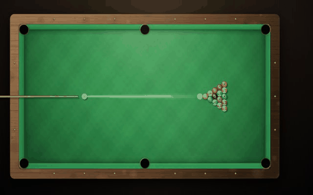
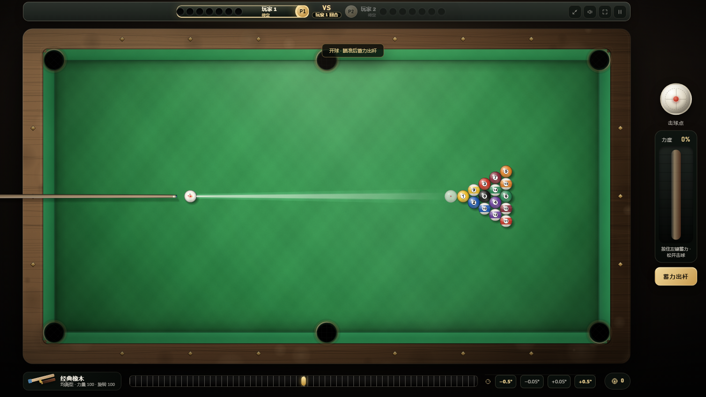
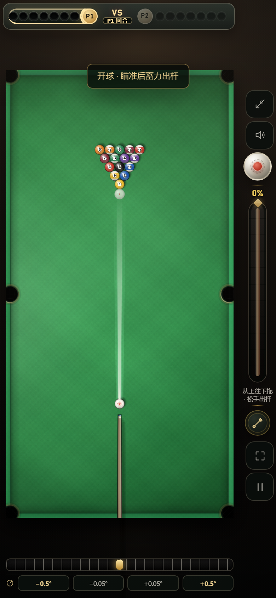
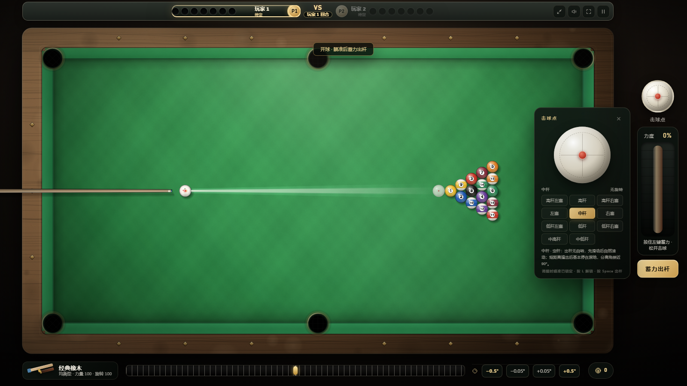
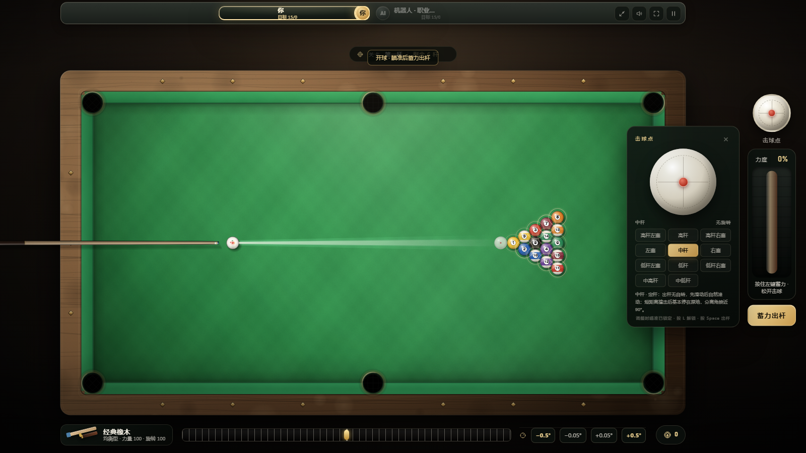
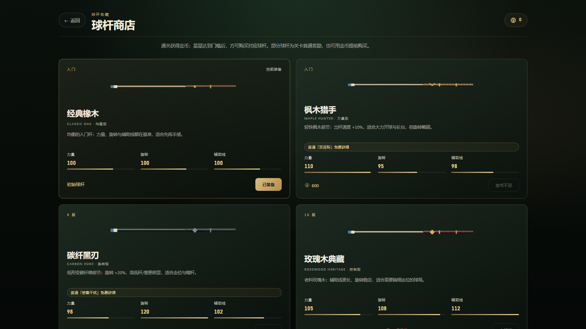
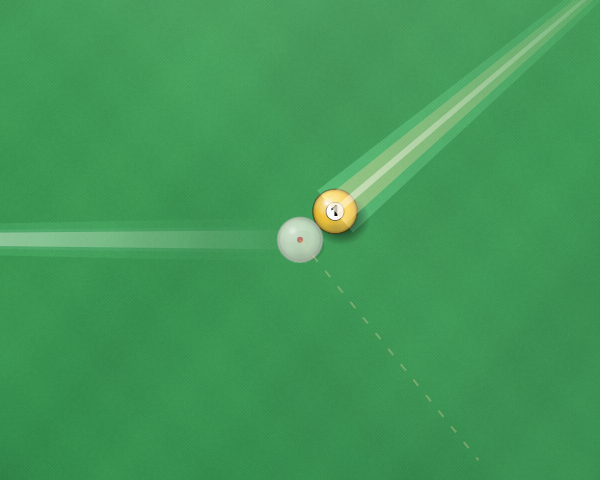

# PRO POOL · 即刻开球

[](https://xingshuwen.com/games/pool/)
[](LICENSE)
[](#测试)
[](#快速开始)

[English](README.md) | **简体中文**

> 一款完全在浏览器里运行的真实物理八球台球游戏。
> 单个 HTML 文件。零依赖、零联网请求、无广告、无需注册。



## ▶ 立即试玩

**<https://xingshuwen.com/games/pool/>** —— 免费、即开即玩，桌面与手机均可。无需安装、无需注册。

## 截图

| 桌面对局 | 手机竖屏 |
|---|---|
|  |  |

| 11 个击球点 | 关卡模式 |
|---|---|
|  |  |

| 球杆商店 | 虚影母球瞄准 |
|---|---|
|  |  |

## 特性

- **真实物理，而非预制动画。** 固定 1/600 s 子步 + 连续碰撞检测（接触时刻法线），滑动/滚动摩擦分离、旋转衰减、库边反弹与真实袋口 jaw。高速球不穿透。
- **与物理一致的瞄准辅助。** 半透明*虚影母球*（与真实母球同一套渲染）标出精确接触位置，另有目标球路径与母球分离线。
- **11 个命名击球点**——中杆、高杆、低杆、中高杆、中低杆、左塞、右塞及四角——每个都附通俗的效果说明。
- **三档差异明显的 AI。** 球房新手 → 职业陪练 → 黑八高手。高手能识别所有可瞄球并具备一杆清台能力；三档"出手命中率"均约 100%（实测，见[测试](#测试)）。
- **模式：** 单人打 AI、本地双人、12 个手工摆放的关卡（星级/金币奖励）、球杆商店（9 支含异形杆，影响力量/旋转/辅助）。
- **完整八球规则：** 开球后开放球台、开球两球吃库、犯规自由球、首次合法进球定组、黑八胜负判定。
- **桌面 + 手机。** 竖屏手机自动旋转为竖向球台；触控目标 ≥ 44 px；细角度尺（±0.05°/±0.5°）与键盘快捷键。
- **无需下载的声音。** WebAudio 合成 + 内嵌短 CC 采样（base64）。运行时零外部请求。
- **单文件构建。** `node scripts/build-standalone.mjs` 产出一个自包含 `dist/pro-pool.html`（约 683 KB），可放到任意静态托管。

## 快速开始

| 目标 | 命令 / 操作 |
|---|---|
| 在线玩 | 打开 **<https://xingshuwen.com/games/pool/>** |
| 本地玩 | 双击 `index.html`（Windows 可用 `启动游戏.bat`） |
| 构建单文件 | `node scripts/build-standalone.mjs` → `dist/pro-pool.html` |
| 跑测试 | `node tests/run_all.mjs` |

游玩与开发都**不需要构建步骤**——游戏是挂在 `window.Pool` 上的经典 `<script>` 文件。

## 操作

| 动作 | 桌面 | 手机 |
|---|---|---|
| 瞄准 | 移动鼠标 | 在球台拖动 |
| 微调角度 | 底部角度尺 / ±0.05° ±0.5° 按钮 / ← →（Shift 更细） | ±0.05° ±0.5° 按钮 / 拖动角度尺 |
| 蓄力出杆 | 按住左键（或空格）后松开 | 按住竖向力度条下拉后松手 |
| 击球点 | 点击击球点圆钮 / 按 `S` | 点按击球点圆钮 |
| 自由球 | 拖动母球 | 拖动母球 |
| 辅助线/声音/暂停/全屏 | `G` / `M` / `Esc` / `F` | 屏幕按钮 |

## 测试

`node tests/run_all.mjs` 运行 **30 套**测试，任一失败以非零码退出：

- 物理单测 + **契约不变量**（碰撞方向与瞄准射线一致、不重叠/不出界、能量不增）
- **物理指纹快照**（golden master：只改 UI 不得改变物理；有意改物理需显式 `--update`）
- **玩家视角验收**（用屏幕虚影母球以常规力度瞄准 → 必须进）
- **AI 梯度**（三档的出手率、连续进球、清台能力）
- 历次 bug 回归固化、颤抖扫描、11 击球点 UI、浏览器启动/音频/DOM 审计、触屏 e2e、浸泡。

## 目录结构

```
index.html            页面 + HUD + 菜单
css/style.css         全部样式（桌面 + 竖屏）
js/config.js          球台/物理/经济/球杆定义
js/physics.js         子步物理 + CCD + 袋口 + castRay
js/renderer.js        Canvas 2D 球台/球/球杆/瞄准辅助
js/audio.js           WebAudio 合成 + 内嵌采样
js/ai.js              候选搜索 + 模拟 + 难度分档
js/levels.js          12 个关卡布局
js/game.js            规则、回合、犯规、计分
js/main.js            输入、UI 绑定、主循环
scripts/              单文件构建 + 开源导出
tests/                30 套测试（Node + Playwright）
docs/                 部署指南、署名、截图、素材
```

## 部署你自己的副本

构建单文件后上传到任意静态托管（GitHub Pages、Netlify、Cloudflare Pages、nginx、对象存储……）。它**不发任何网络请求**，因此 `file://` 双击也能玩。详见 [docs/DEPLOY.md](docs/DEPLOY.md)。

## 署名与许可

- 代码：**MIT** —— 见 [LICENSE](LICENSE)。
- 音效采样：Creative Commons，署名见 [docs/CREDITS.md](docs/CREDITS.md)。
- 球台/球/球杆/UI 全部由 Canvas 程序化绘制。**不含任何商业游戏素材。**

## 参与贡献

欢迎 Issue 与 PR。提交前请跑 `node tests/run_all.mjs`；若有意修改物理，请用 `node tests/physics_snapshot.test.js --update` 更新指纹快照并在 PR 中说明原因。
